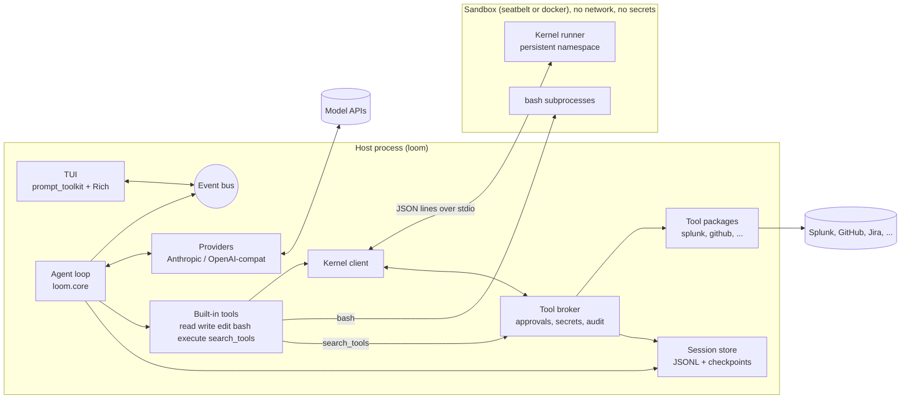
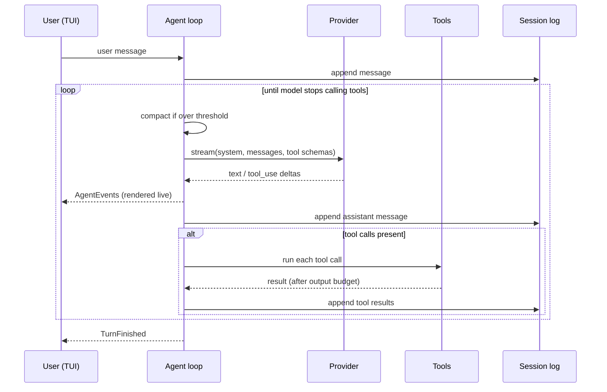
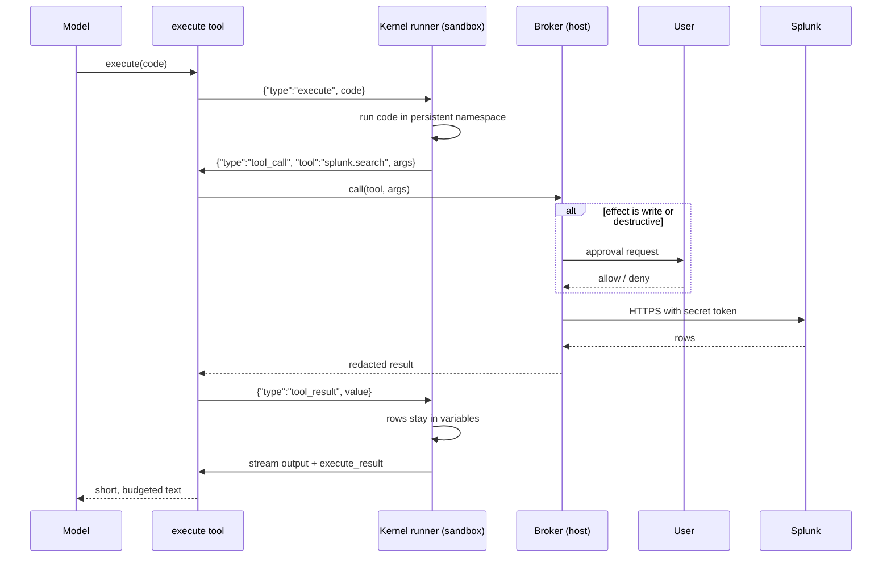

# 01 — Architecture

## Components

| Component | Package | Runs where | Responsibility |
|---|---|---|---|
| CLI | `loom.cli` | host | Parse args, load config, start session, start TUI |
| Agent loop | `loom.core` | host | Turn loop, message history, tool dispatch, compaction, emits `AgentEvent`s |
| Providers | `loom.providers` | host | Adapters from canonical messages to Anthropic, OpenAI-compatible (Chat Completions) and OpenAI Responses APIs; model profiles and capabilities |
| Built-in tools | `loom.tools` | host | `read`, `write`, `edit`, `bash`, `execute`, `search_tools`; output budget |
| Kernel client | `loom.kernel.client` | host | Starts the kernel runner inside the sandbox, speaks the JSON-lines protocol |
| Kernel runner | `loom/kernel/runner.py` | **sandbox** | Stdlib-only persistent Python namespace; executes code; forwards tool calls to host |
| Tool broker | `loom.broker` | host | Tool package registry, approvals, secrets, redaction, audit log; executes tool functions |
| Sandbox backends | `loom.sandbox` | host | `none`, `seatbelt`, `docker`: launch processes (kernel, bash) with isolation |
| Sessions | `loom.session` | host | JSONL session store, resume, checkpoints (`/undo`) |
| Tracing | `loom.tracing` | host | Session event log; optional OpenTelemetry export |
| Skills / extensions | `loom.skills`, `loom.extensions` | host | Discover `SKILL.md`; load Python extensions with hooks |
| Sub-agents | `loom.agents` | host | Headless child agent loops, callable from the kernel |
| TUI | `loom.tui` | host | prompt_toolkit input, Rich rendering, approval prompts, slash commands |

## Component diagram



Key property: the only path from the sandbox to the outside world is the stdio pipe to the kernel client, and every request on it goes through the broker.

## One user turn



## Code-mode call path



## Package layout

```
loom/
  pyproject.toml
  CLAUDE.md
  docs/
  src/loom/
    __init__.py
    __main__.py
    cli.py
    config.py
    core/
      agent.py          # AgentLoop
      messages.py       # canonical message + block types
      events.py         # AgentEvent types, EventBus
      context.py        # system prompt assembly, context files, skills list
      compaction.py
      prompts/system.md
    providers/
      base.py           # Provider protocol, ProviderEvent
      anthropic.py
      openai_compat.py
      openai_responses.py
      profiles.py       # ModelProfile, ModelCapabilities, built-in defaults
      text_tools.py     # text tool-call fallback for models without native tools
      fake.py           # FakeProvider for tests
      registry.py
    tools/
      base.py           # Tool protocol, ToolResult
      budget.py         # output budget + spill files
      builtin/{read,write,edit,bash,execute,search_tools}.py
    kernel/
      protocol.py       # message dataclasses (host side)
      client.py         # KernelClient
      runner.py         # STDLIB ONLY, runs inside sandbox
    broker/
      broker.py         # ToolBroker
      registry.py       # tool package discovery, @tool decorator
      approval.py
      secrets.py
      redact.py
    sandbox/
      base.py           # SandboxBackend protocol
      none.py
      seatbelt.py
      seatbelt.sb.tmpl
      docker.py         # drives the docker CLI
      Dockerfile
    session/{store,checkpoints}.py
    tracing/{log,otel}.py
    skills/loader.py
    extensions/{api,loader}.py
    agents/subagent.py
    tui/{app,input,render,approvals,commands}.py
  packages/
    loom-tools-splunk/
    loom-tools-demo/    # synthetic data, used by tests
  tests/
```
