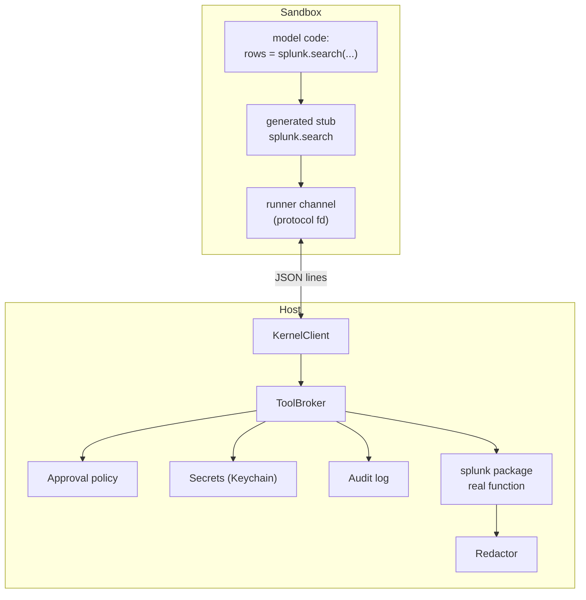

# 04 — Kernel and broker (code mode)

This is the heart of loom. Two cooperating parts:

- **Kernel runner** (`loom/kernel/runner.py`): a stdlib-only Python process **inside the sandbox** that holds a persistent namespace and executes code.
- **Tool broker** (`loom.broker`): a host-side component that owns tool packages, secrets, approvals and audit. Kernel code calls tools through generated stubs; each call travels over the kernel's stdio channel to the host, and the broker executes it.



## Kernel lifecycle

- Started lazily on first `execute` (or eagerly with `[kernel] eager = true`).
- One kernel per session. Sub-agents get their own kernel.
- States: `off → starting → idle ⇄ busy → dead`. Emitted as `KernelStatus(state, vars)` events (`vars` = number of user variables, reported by the runner after every execution); shown in the TUI footer.
- Started as `<python> -I <session_dir>/sandbox/runner.py` with cwd = workspace. `-I` keeps `PYTHON*` variables and user site-packages out; the runner then puts the workspace on `sys.path` so `import mymodule` works as in Jupyter.
- On crash/timeout kill: restarted on next `execute`, and the next result is prefixed with `[kernel restarted — previous variables are gone]` (once). An unexpected exit also emits a `Notice`. A timeout kills the kernel (no SIGINT first). Startup failures become an `execute` error result, not a crash.
- `/kernel` shows the inventory; `/kernel reset` restarts it.

## Protocol (JSON lines)

Transport: the runner's original stdout/stdin. At startup the runner **dup()s fds 0 and 1 to private (non-inheritable) protocol fds**, points fd 0 at `/dev/null`, then redirects fd 1 and fd 2 to pipes read by background threads, so that `print()`, `input()`, C extensions, and subprocesses spawned by model code can never corrupt the protocol stream. All captured output becomes `stream` messages. After each execution the runner writes a sync marker into both pipes and waits until the capture threads reach it, so every `stream` message of an execution precedes its `execute_result`. Output arriving between executions (background threads/processes) is sent with `"id": null` and dropped by the host.

Every message is one JSON object per line, UTF-8. Host → kernel:

```jsonc
{"type": "init", "catalog": [...], "settings": {"repr_max": 2000, "out_max_chars": 12000}}  // first message
{"type": "execute", "id": "e7", "code": "rows = splunk.search(...)\nlen(rows)"}
{"type": "tool_result", "call_id": "c3", "ok": true, "value": [...]}
{"type": "tool_result", "call_id": "c3", "ok": false, "error": {"type": "PermissionDenied", "message": "User denied splunk.restart_app"}}
{"type": "inventory", "id": "i1"}
{"type": "shutdown"}
```

Kernel → host:

```jsonc
{"type": "ready", "python": "3.12.6", "pid": 4242}   // sent after `init` is applied
{"type": "stream", "id": "e7", "name": "stdout", "text": "..."}
{"type": "tool_call", "id": "e7", "call_id": "c3", "tool": "splunk.search", "args": {"spl": "..."}}
{"type": "execute_result", "id": "e7", "status": "ok", "value_repr": "48211", "duration_ms": 913, "vars": 3}
{"type": "execute_result", "id": "e8", "status": "ok", "duration_ms": 40, "vars": 3, "out_ref": 8}  // full text kept as _out[8]
{"type": "execute_result", "id": "e7", "status": "error", "error": {"ename": "KeyError", "evalue": "'host'", "traceback": "..."}}
{"type": "inventory_result", "id": "i1", "vars": [{"name": "rows", "type": "list", "summary": "len=48211"}, {"name": "df", "type": "DataFrame", "summary": "48211x7"}]}
```

`args` is always a single dict of named parameters: the stub binds positional and keyword arguments with `inspect.Signature.bind`, applies defaults, and sends the result. Tool functions therefore may not use `*args`/`**kwargs` (the registry rejects them).

`inventory` is answered by the runner's protocol thread, so it works while a cell runs.

Interrupt: the host sends **SIGINT** to the runner process (not a protocol message), which raises `KeyboardInterrupt` in the executing code (the runner's handler ignores SIGINT while idle); the runner replies with `execute_result` status `error`, ename `KeyboardInterrupt`. If no reply within 3 s, the host kills the process (kernel → dead). The runner is spawned in its own process group (`05-sandbox.md`), so a terminal Ctrl+C reaches only loom, which decides whether to interrupt.

Abandoned calls: if an execution is interrupted or times out while a stub is waiting, the host cancels that broker call (a pending approval resolves as deny, logged with `by: "cancel"`). A `tool_result` for an unknown or abandoned `call_id` is dropped by the runner.

Serialization: tool args and results must be JSON-serializable (dicts, lists, str, int, float, bool, None). The broker converts datetimes to ISO strings and bytes to base64 (with a `{"__bytes__": ...}` wrapper the stub decodes). Large results are fine — this pipe is not the model's context.

## Runner behavior (stdlib only)

```python
ns = {"__name__": "__loom__", "_out": {}}
# On init: build stub modules from the catalog and insert into ns and sys.modules:
#   ns["splunk"] = <module splunk with function search(...)>
#   ns["tools"]  = namespace object with all packages
#   ns["agents"] = stub for sub-agents (M10)

def execute(code):
    tree = ast.parse(code, mode="exec")
    last_expr = tree.body.pop() if tree.body and isinstance(tree.body[-1], ast.Expr) else None
    exec(compile(tree, "<cell>", "exec"), ns)
    if last_expr:
        value = eval(compile(ast.Expression(last_expr.value), "<cell>", "eval"), ns)
        if value is not None:
            ns["_"] = value
            return reprlib_limited(value)
```

- Errors (including `SyntaxError`, `KeyboardInterrupt`, `SystemExit`) become `status: "error"`; the traceback starts at the first `<cell eN>` frame, and cell source is registered with `linecache` so tracebacks show the failing line. `sys.exit()` does not end the kernel.
- The namespace is a real module (`__loom__`, registered in `sys.modules`) so classes defined in cells can be pickled. The inventory lists names not starting with `_`, excluding modules and names the runner put there itself (stubs).
- Top-level `await` is supported by compiling with `ast.PyCF_ALLOW_TOP_LEVEL_AWAIT` and running the coroutine on a runner-owned event loop.
- Stubs are **synchronous**: a stub writes a `tool_call` message and blocks on a per-call `threading.Event` until the matching `tool_result` arrives (a reader thread dispatches incoming messages). This keeps model code simple (`rows = splunk.search(...)`).
- Stubs carry real signatures and docstrings (`inspect.Signature` built from the catalog), so `help(splunk.search)` works inside the kernel.
- `pandas`, `numpy`, `pyarrow` may be present in the sandbox Python (Docker image / venv) but the runner never requires them.

## Tool packages (`loom.broker.registry`)

A tool package is a normal Python package installed in loom's host environment, registered via an entry point:

```toml
# packages/loom-tools-splunk/pyproject.toml
[project.entry-points."loom.tools"]
splunk = "loom_tools_splunk:package"
```

```python
# loom_tools_splunk/__init__.py
from loom.broker import ToolPackage, tool, Secret

package = ToolPackage(
    name="splunk",
    description="Search Splunk with SPL; list indexes and saved searches.",
    secrets={"token": Secret("splunk_token")},
    config_keys=["host", "port", "verify_tls", "allowed_indexes"],
)

@package.tool(effect="read")
def search(ctx, spl: str, earliest: str = "-1h", latest: str = "now", max_rows: int = 1000) -> list[dict]:
    """Run an SPL search and return result rows.
    Aggregate with stats/timechart in SPL where possible; keep max_rows small."""
    svc = ctx.client("splunk")   # cached splunklib client built with ctx.secret("token")
    ...

@package.tool(effect="read")
def list_indexes(ctx) -> list[str]: ...

@package.tool(effect="write")
def create_saved_search(ctx, name: str, spl: str) -> dict: ...
```

- `ctx` is injected by the broker (never visible in the stub signature). It provides `secret(name)`, `config` (the package's `[packages.<name>]` table), `client(name)` (per-session cached clients), `log`.
- `effect` is one of `read`, `write`, `destructive`. Required.
- Package functions may be sync or async; sync ones run via `asyncio.to_thread`.
- `loom-tools-demo` ships synthetic logs/tickets with no external dependencies; it powers tests and the first-run tutorial.

## Broker call pipeline

For every `tool_call` from the kernel:

1. **Resolve** `tool` in the catalog → unknown: error `ToolNotFound` with nearest names.
2. **Validate** args against the function signature (pydantic `validate_call`).
3. **Hooks**: extension `before_broker_call` hooks may modify or block (`before_tool_call` is for built-in tools; see `08-…`).
4. **Approve** (see policy table). Emit `ApprovalRequested` and await the decision when needed.
5. **Execute** with timeout (`[broker] call_timeout_s`, default 120). Exception: `agents.*` calls have no broker timeout (bounded by their own `max_turns`) and, like approvals, pause the `execute` timeout clock.
6. **Redact**: scrub any configured secret values and known token patterns from the result (recursively through dicts/lists).
7. **Log** to the session: tool, args, effect, decision, duration, result size (not the full result unless `[tracing] log_tool_results = true`).
8. **Return** `tool_result` to the kernel.

## Approval policy (`loom.broker.approval`)

| Mode (`--mode`) | read | write | destructive |
|---|---|---|---|
| `read-only` | allow | deny | deny |
| `ask` (default) | allow | ask | ask |
| `auto-write` | allow | allow | ask |
| `yolo` | allow | allow | allow |

Decisions offered in the prompt: **allow once**, **allow `<tool>` for this session**, **deny**, **deny with message** (the message is returned to the model as the error text). Per-tool overrides in config (`[approvals.overrides] "splunk.create_saved_search" = "allow"`). The `execute` timeout clock pauses while an approval is pending. Concurrent approval requests (threads in kernel code, sub-agents) are queued and shown one at a time.

This table covers broker (kernel) tools. Built-in tools follow the sandbox-aware table in `03-tools.md`.

## Secrets (`loom.broker.secrets`)

- Stored in the macOS Keychain via `keyring` (service `loom`, account = secret name). `loom secrets set splunk_token` prompts with hidden input.
- Fallback: environment variable `LOOM_SECRET_<NAME>` (for CI).
- Resolved only on the host by `SecretStore`, for the broker and provider adapters. Never placed in sandbox env, tool results, logs, or prompts. The redactor holds the resolved values to scrub them from outputs and from the session log.
